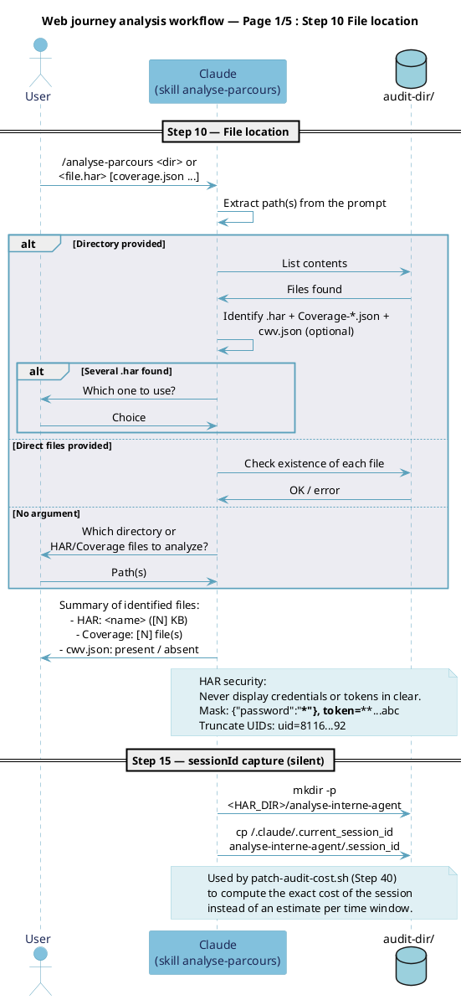
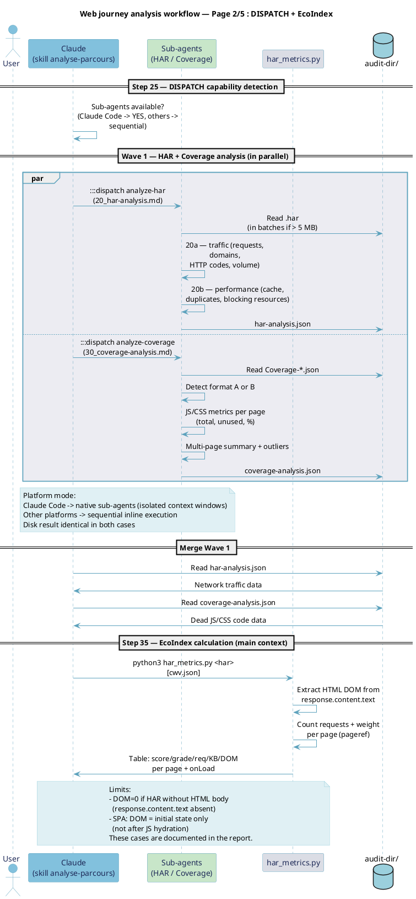
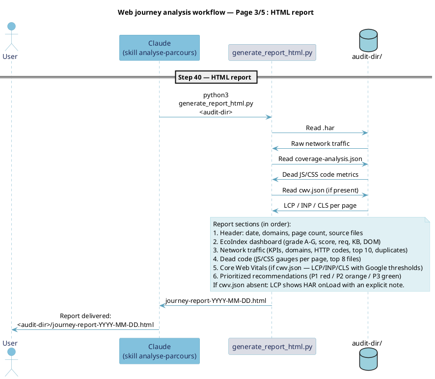
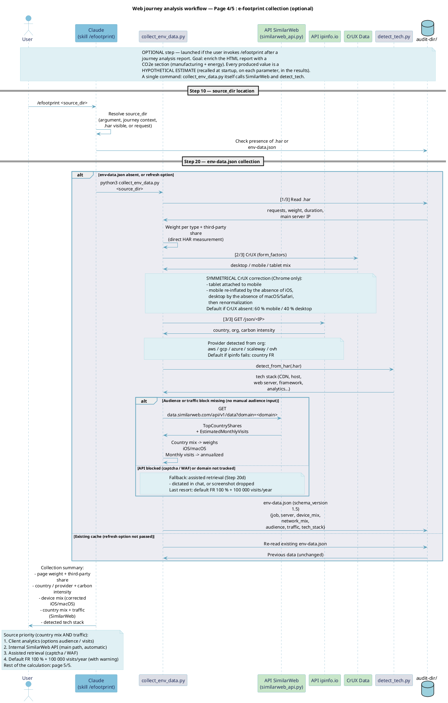

# Skill: Diagrams — Web journey analysis

## Diagram registry

| Diagram | Source files (`.puml`) | Produced files | Source of truth | Regenerate if... |
|---------|--------------------------|-------------------|------------------|-----------------|
| Overview (macro, by theme) | `analyse-parcours-vue-generale.puml` | `analyse-parcours-vue-generale.pdf` | Synthesis of 7 blocks (Manual capture, Collection, Automatic EOF judgment, CO2e impact, Report - first generation, EOF questionnaire, Report - regeneration): no single source, it is a deliberately macro summary. The Manual capture block (HAR then Coverage, sequential, a single column) precedes Collection: it is the human step outside the skill, before any automation — detailed in [`capture-har-and-coverage.md`](../analyse-parcours/docs/capture-har-and-coverage.md), referenced in the diagram by a `[ref]` marker (block title + 3rd legend line; no icon drawn here, this diagram is generated by `plantuml`, not hand-built). Since 2026-09-18, the legend is a single `legend top right`/`endlegend` block (one bordered rectangle, as in `analyse-parcours-vue-generale-horizontal-light.svg`) and no longer 3 separate notes: pitfall encountered, `<back:#color>` on empty text or spaces (including `&nbsp;`/NBSP Unicode) produces NO visible swatch, PlantUML prunes them before rendering — you need non-blank filler characters colored in the SAME color as the background (`<back:#ECECF2><color:#ECECF2>XXXXXX</color></back>`) to get a solid swatch invisible in text. Report appears twice (before and after the questionnaire) to show the two passes; CO2e impact is positioned before the first generation because its data, once calculated, feeds the next report generation, not an isolated final add-on. 2-color legend (pale grey background `#ECECF2` = automatic, Octo light blue background `#9BD0DD` = human action required) on the Manual capture, CO2e impact and EOF questionnaire blocks | one of the detailed diagrams below changes theme (new major step, block merge/split), the manual capture procedure changes, or the provenance precedence rule changes (`process/lots-manifest.json::precedence_rule`) |
| Overview (macro, horizontal, 2 columns) | `analyse-parcours-vue-generale-horizontal-light.puml` (reference text only, does not drive the rendering) | `analyse-parcours-vue-generale-horizontal-light.svg` (**hand-built, NEVER regenerate via `plantuml -tsvg`** — PlantUML cannot produce this layout, cf. header comment of the `.svg`) + `.pdf` + `.jpg` + `.pptx` | The `.svg` itself is the source of truth for the layout (2 columns of 440px each, width measured to the pixel on the longest text line — `magick -threshold -trim` on the real render, not an estimate, cf. header comment of the `.svg` — on 2026-09-18, body font 14px / titles 16px, U-shaped connector with rounded corners flush with the blocks, Manual capture block on top in a single HAR-then-Coverage column, legend top right — occupies the dead space above Report, which is therefore no longer aligned with Collection, the connector enters Report from the left side rather than the top); the `.puml` only serves to keep the text in sync with the other diagrams of this project. Content of the Manual capture block detailed in [`capture-har-and-coverage.md`](../analyse-parcours/docs/capture-har-and-coverage.md), referenced IN the `.svg` since 2026-09-18 by a vector-drawn book icon (rect + spine + 2 lines, NOT a color emoji — tested and confirmed: rsvg-convert renders any color emoji as a solid black square, even with explicit Apple Color Emoji, and the PPTX would inherit it since it goes back through a PNG rendered by rsvg-convert): mini marker next to the Manual capture title + full-size icon on the 3rd line of the Legend (file name + relative path) | the text changes (port it by hand into BOTH the `.puml` and the `.svg`), or the layout changes (widths, font, corners, arrows, legend) — then regenerate `.pdf`/`.jpg`/`.pptx` via the procedures below |
| Main workflow (5 pages) | `analyse-parcours-p1.puml` `analyse-parcours-p2.puml` `analyse-parcours-p3.puml` `analyse-parcours-p4.puml` `analyse-parcours-p5.puml` | `analyse-parcours-workflow.pdf` | `analyse-parcours/SKILL.md` (p1-p3) + `analyse-parcours/skill-steps/45_efootprint.md` (p4-p5) | one of the source files changes (steps, participants) |
| DISPATCH — wave flow (activity) | `analyse-parcours-dispatch-activite.puml` | `analyse-parcours-dispatch-activite.pdf` | `skill-steps/25_dispatch-orchestration.md` | `25_dispatch-orchestration.md` changes (waves, dispatches) |
| e-footprint — tool pipeline (activity) | `analyse-parcours-efootprint-outils.puml` | `analyse-parcours-efootprint-outils.pdf` | `collect_env_data.py` + `run_efootprint.py` + `generate_report_html.py` (real script code) | one of these 3 scripts changes its inputs/outputs or its called sub-tools |
| e-footprint — site topology (components) | GENERATED on demand, no fixed `.puml` in the repo | variable (depends on the requested site/archetype) | `efootprint_model/to_plantuml.py::site_to_plantuml()` (reads a `SiteSpec`) | never regenerate by hand: this diagram is produced by calling `site_to_plantuml(spec)` on the current spec, cf. dedicated section below. Since Step 25 of the efootprint skill, ALSO produced systematically (not only on demand), via `run_efootprint.py::build_topology_overview()`. Third-party hosts annotated with a DB/streaming/AI suspicion (`efootprint_model/topology_overview.py`) display their note in the component label. |
| EOF — tool pipeline (activity, 2 pages) | `eof-pipeline-outils.puml` (contains 2 diagrams: `eof-pipeline-outils` + `eof-radar-svg`) | `eof-pipeline-outils.pdf` (2 pages) | `.claude/skills/eof/scripts/build_template.py` (page 1: gviz retrieval + Markdown construction) + `.claude/skills/eof/scripts/generate_radar_svg.py` (page 2, independent pipeline) | one of the 2 scripts changes its inputs/outputs, or the list of `gid`/tabs of the source Google Sheet changes |
| EOF-audit — tool pipeline (activity) | `eof-audit-pipeline.puml` | `eof-audit-pipeline.pdf` | `.claude/skills/analyse-parcours/scripts/run_eof.py` + `eof_criteria_mapping.py` + the 3 Phase 1 extractors (`parse_html_criteria.py`, `analyze_security_headers.py`, `scan_wellknown.py`) + the a11y/best-practices extension of `collect_cwv_pagespeed.py` | one of these scripts changes its inputs/outputs, or the number of automatable criteria/hints evolves (Phase 2, `eof-questionnaire`) |
| EOF questionnaire — sequence (3 pages) | `eof-questionnaire-sequence-p1.puml` `eof-questionnaire-sequence-p2.puml` `eof-questionnaire-sequence-p3.puml` | `eof-questionnaire-sequence.pdf` | `analyse-parcours/skill-steps/39_eof-audit.md` (page 1: what the audit launches on its own) + `scripts/generate_questionnaire.py` (page 2) + `scripts/parse_questionnaire.py` and `process/merge_lots.py` (page 3) | a skill step starts calling `generate_questionnaire.py` (today none does, and that is the subject of page 1), the number of questions changes (today 45 technical + 17 product-usage), the provenance set by the read-back changes, or the precedence axis changes |

All `.puml` files and the outputs live in `documentation/diagrammes/` at the project root.

-----

## General regeneration procedure

For each modified diagram:
1. Edit the `.puml` in `documentation/diagrammes/` consistently with the source of truth
2. Generate the SVG: `plantuml -tsvg <file>.puml`
3. Convert to PDF via `rsvg-convert`
4. Also generate the lightweight JPG (see "Lightweight JPG" below) — systematic, not only on demand
5. If this diagram has a `.pptx` (cf. "Produced files" column of the registry), regenerate it too (see "PPTX" below) — otherwise it stays silently stale
6. Check + open

**Never generate directly to PNG or PDF from plantuml.** Always go through SVG (vector) then `rsvg-convert` for the PDF.

### Lightweight JPG (systematic after each SVG regeneration)

Each `.svg` in this directory has a lightweight `.jpg` version next to it (same name, 800px
wide, quality 85) — for sharing/insertion into a doc or a slide without the weight
of the PDF/SVG. To regenerate after EACH modification of an `.svg` (including for a
hand-built diagram, like `analyse-parcours-vue-generale-horizontal-light.svg`).

```bash
f=<name-without-extension>
rsvg-convert -b white -w 800 documentation/diagrammes/$f.svg -o /tmp/$f.png \
  && magick /tmp/$f.png -quality 85 documentation/diagrammes/$f.jpg \
  && rm /tmp/$f.png
```

To regenerate everything at once (ex. after a convention change):

```bash
cd documentation/diagrammes
for f in *.svg; do
  base="${f%.svg}"
  rsvg-convert -b white -w 800 "$f" -o "/tmp/${base}.png" \
    && magick "/tmp/${base}.png" -quality 85 "${base}.jpg" \
    && rm "/tmp/${base}.png"
done
```

### PPTX (only for the diagrams that need it, ex. overview horizontal-light)

Some diagrams (today: `analyse-parcours-vue-generale-horizontal-light`)
also have a `.pptx` version, for insertion into a presentation. This `.pptx` was
created a first time (2026-09-16) **manually** outside the repo (SVG → PowerPoint
export), without a regeneration procedure — a pitfall identified on
2026-09-18: any future modification of the `.svg` left the `.pptx` stale without
anyone noticing.

Since then, regeneration is scripted by
`.claude/skills/diagrammes-analyse-parcours/scripts/svg_to_pptx.sh`:

```bash
.claude/skills/diagrammes-analyse-parcours/scripts/svg_to_pptx.sh documentation/diagrammes/<f>.svg
```

The script renders the SVG to a high-resolution PNG (`rsvg-convert`), builds a
minimal `.odp` by hand (one slide, the image full-frame, standard 16:9
PowerPoint format) then converts it to `.pptx` via `soffice --headless` (LibreOffice,
already installed — `/opt/homebrew/bin/soffice`). Detour needed: LibreOffice has
no direct SVG/PNG → PPTX export filter (these formats open as Draw
documents, which can only export to Draw formats); it does however convert a
presentation document (ODP) to PPTX very well.

**Limit to know:** the diagram is embedded as an image in the slide
(as in the PDF/JPG), not as editable vector shapes in PowerPoint —
consistent with the fact that the `.svg` itself is hand-built, not generated
from structured shapes.

**Pitfall encountered when writing the script:** `awk` respects the system locale for
the decimal separator. On this Mac (FR locale), `awk '{printf "%.3f", ...}'` without
precaution produces `19,538` (comma) instead of `19.538` (point) — an invalid
ODF dimension that makes LibreOffice fall back to a near-zero slide height
(the image then appears just empty/white). Always force
`LC_NUMERIC=C awk ...` for dimension calculations destined to XML.

-----

## Diagram 1 — Main workflow (sequence)

**Source of truth:** `analyse-parcours/SKILL.md` (pages 1-3, Steps 10 to 40) +
`analyse-parcours/skill-steps/45_efootprint.md` (pages 4-5, Steps 10 to 50 of the /efootprint skill).

The workflow assembles the base journey (p1-p3) AND the optional e-footprint
module (p4-p5). The titles carry the global numbering « Page X/5 ».

### Structure of the 5 files

| File | Participants | Steps covered |
|---------|--------------|-----------------|
| `analyse-parcours-p1.puml` | U, C, FS | Steps 10+15 — Location + sessionId capture |
| `analyse-parcours-p2.puml` | U, C, SA, EI, FS | Steps 25+35 — DISPATCH + EcoIndex |
| `analyse-parcours-p3.puml` | U, C, GR, FS | Step 40 — CWV Lighthouse + HTML report |
| `analyse-parcours-p4.puml` | U, C, CED, SW, IP, CR, DT, FS | e-footprint Steps 10+20 — Collection (SimilarWeb, CrUX+iOS/macOS correction, ipinfo, detect_tech) |
| `analyse-parcours-p5.puml` | U, C, REF, GR, FS | e-footprint Steps 30+40+50 — Questions, calculation, summary, report enrichment |

Split into separate files: each page only shows the active participants
(the `newpage` technique in a mono-file does not reduce the columns). Pages
p4-p5 are OPTIONAL (skill `/efootprint`) but included in the assembled PDF.

### Commands

```bash
plantuml -tsvg documentation/diagrammes/analyse-parcours-p1.puml \
          documentation/diagrammes/analyse-parcours-p2.puml \
          documentation/diagrammes/analyse-parcours-p3.puml \
          documentation/diagrammes/analyse-parcours-p4.puml \
          documentation/diagrammes/analyse-parcours-p5.puml
rsvg-convert -f pdf -o documentation/diagrammes/analyse-parcours-workflow.pdf \
  documentation/diagrammes/analyse-parcours-p1.svg \
  documentation/diagrammes/analyse-parcours-p2.svg \
  documentation/diagrammes/analyse-parcours-p3.svg \
  documentation/diagrammes/analyse-parcours-p4.svg \
  documentation/diagrammes/analyse-parcours-p5.svg
ls -lh documentation/diagrammes/analyse-parcours-workflow.pdf
open documentation/diagrammes/analyse-parcours-workflow.pdf
```

### Reference content — analyse-parcours-p1.puml



### Reference content — analyse-parcours-p2.puml



### Reference content — analyse-parcours-p3.puml



### Reference content — analyse-parcours-p4.puml

**Source of truth:** `analyse-parcours/skill-steps/45_efootprint.md` (Steps 10 and 20, including 20b/20c/20e
SimilarWeb, CrUX iOS/macOS correction) + `collect_env_data.py` (real flow, defaults,
providers) + `detect_tech.py`. Points to re-check if this step changes: default mix
60 % mobile / 40 % desktop (not 100 % desktop), supported providers
`aws / gcp / azure / scaleway / ovh`, `schema_version` of `env-data.json`, automatic
SimilarWeb call integrated into `collect_env_data.py`.



### Reference content — analyse-parcours-p5.puml

**Source of truth:** `analyse-parcours/skill-steps/45_efootprint.md` (Steps 30, 40, 50) + `run_efootprint.py`
(Boavizta model, `efootprint-python-summary.json` schema, and `run_recommendation_scenarios()` for
`efootprint-recommendations-gains.json`) + `generate_report_html.py` (CO2e section, "Estimated CO2e gain" / "Estimated EcoIndex & LCP gain" blocks, appendix F/G). Points to re-check if the code
changes: structure of `efootprint-python-summary.json` (`traffic` block, `totals` with
`fabrication_kg_co2e_per_year` / `energy_kg_co2e_per_year` dicts, big `hypotheses` block), position of
the section (between CWV and Appendices), traffic reused from the `traffic` block if already resolved,
lettering of the Methodology appendix sub-sections (currently A to H, cf. Diagram 3 for the
detail of the EcoIndex/LCP gain by tier).

```plantuml
@startuml analyse-parcours-p5
title Web journey analysis workflow — Page 5/5 : e-footprint calculation + report (optional)

skinparam backgroundColor #FFFFFF
skinparam participant {
  BackgroundColor #E0F0F4
  BorderColor #5BA1BC
  FontColor #1C2856
}
skinparam actor {
  BackgroundColor #E0F0F4
  BorderColor #5BA1BC
  FontColor #1C2856
}
skinparam ArrowColor #5BA1BC
skinparam SequenceLifeLineBorderColor #5BA1BC
skinparam SequenceGroupBodyBackgroundColor #ECECF2
skinparam SequenceGroupBorderColor #5BA1BC
skinparam NoteBackgroundColor #E0F0F4
skinparam NoteBorderColor #9BD0DD
skinparam sequenceMessageAlign center
skinparam maxMessageSize 200
skinparam responseMessageBelowArrow true

actor "User" as U #82C1DD
participant "Claude\n(skill /efootprint)" as C #82C1DD
participant "run_efootprint.py" as REF #DBDDE5
participant "generate_report_html.py" as GR #DBDDE5
database "audit-dir/" as FS #9BD0DD

note over U, FS
  Rest of page 4/5: env-data.json is ready. We ask for the non
  auto-detectable hypotheses, we calculate, we summarize, we enrich the HTML report.
  Reminder: every value remains a HYPOTHETICAL ESTIMATE.
end note

== Step 30 — User parameters ==

C -> C : Traffic already resolved (traffic block\nSimilarWeb or client analytics) ?

alt Traffic already resolved (page 4)
  note over C : Do not ask the question again:\nreuse the volume resolved at Step 20c.
else No traffic source
  C -> U : AskUserQuestion — annual traffic\n(10k / 100k / 500k / 1M, or free)
  U -> C : Traffic retained (option visits)
end

alt Supported cloud provider detected\n(aws / gcp / azure / scaleway / ovh)
  C -> U : AskUserQuestion — instance size\n(ex. AWS: t3.medium default, t3.large, m5.large...)
  U -> C : Instance retained (option instance)
else Unknown or unsupported provider
  note over C : No question:\nrun_efootprint switches to generic Server.
end

note over C, U
  Always remind that these are hypotheses.
  Weight, duration, device mix, country: imposed by env-data.json
  (to change them, edit env-data.json then rerun).
end note

== Step 40 — e-footprint calculation ==

C -> REF : python3 run_efootprint.py <source_dir>\n[option visits N] [option instance TYPE]
REF -> FS : Read env-data.json
FS -> REF : Environment data

REF -> REF : Build Boavizta model:\n- Devices (2 profiles: mobile / desktop)
- Network (mobile -> mobile network, desktop -> wifi)
- Server (cloud instance or generic)
- Storage (50 GB hypothesis)

REF -> REF : Impact calculation:\n- Manufacturing (dict per item)
- Energy (dict per item)
- Total kg/year + g/visit

REF -> FS : efootprint-boavizta-model.json\n(full serialized model)
REF -> FS : efootprint-python-summary.json\n(totals + hypotheses, lightweight format)

note over REF, FS
  efootprint-python-summary.json (extract):
  {
    "visits_per_year": ...,
    "traffic": {source, source_url, snapshot, confidence},
    "totals": {
      "total_kg_co2e_per_year": ...,
      "per_visit_g_co2e": ...,
      "fabrication_kg_co2e_per_year": {item: kg},
      "energy_kg_co2e_per_year": {item: kg}
    },
    "hypotheses": {
      page_weight_kb, request_duration_ms,
      weight_by_type_bytes, third_party_share,
      country, carbon_intensity_g_kwh, provider, instance_type,
      phone_fraction / desktop_fraction (corrected iOS/macOS),
      audience_mix + source, device_scenarios,
      + confidence level per field
    }
  }
end note

REF -> REF : Automatic — Recommendation scenarios\n(recommendations.py): REAL recalculation of the model\nfor 3 cumulative tiers (prio1 / prio1+2 / prio1+2+3)
REF -> FS : efootprint-scenario-{tier}.e-f.json (x4)\n+ efootprint-recommendations-gains.json

note over REF, FS
  No question asked to the user for this step:
  fully automatic, from the same thresholds
  prio1/prio2/prio3 already used by the qualitative
  recommendations of the report (dead JS/CSS, duplicates, Brotli).
end note

REF -> C : stdout: hypotheses table\n+ raw CO2e results

== Step 50 — Summary and report enrichment ==

C -> U : Summary (3 lines):\n- ~{total} kg CO2e/year\n- ~{per_visit} g CO2e/visit\n- Dominant item: devices / server / network / storage

C -> U : AskUserQuestion — and then?\n- Rerun with other hypotheses\n- Recollect (option refresh)\n- Regenerate the HTML report\n- Finish

alt Regenerate the HTML report
  C -> GR : python3 generate_report_html.py <audit-dir>
  GR -> FS : Read efootprint-python-summary.json\n(+ har, coverage, cwv, tech_stack)
  FS -> GR : Report data
  GR -> GR : Insert section "Environmental\nimpact (CO2e)"\nbetween CWV and Appendices
  GR -> GR : Recommendations -> block "Estimated CO2e gain"\n+ block "Estimated EcoIndex & LCP gain"\n(if efootprint-recommendations-gains.json present)
  GR -> FS : journey-report-YYYY-MM-DD.html
  GR -> C : Report path
  C -> U : Enriched report delivered\n(CO2e KPIs, manufacturing/energy breakdown,\nmethodology appendix A to H,\nincluding F. Recommendations and G. EcoIndex/LCP)
end

note over U, C
  Human-in-the-loop loop: no automatic iteration.
  CO2e section omitted if efootprint-python-summary.json absent (backward-compatible report).
end note

@enduml
```

-----

## Diagram 2 — DISPATCH (analysis wave flow)

**Source of truth:** `skill-steps/25_dispatch-orchestration.md`

### Description

Activity diagram (PlantUML beta syntax) with `fork` / `fork again` / `end fork`.
Represents the vertical flow of the waves with the parallel branches.
Mono-file, a single page.

### Structure

```
Wave 0  — Location (main context)
Wave 1  — HAR + Coverage + CWV + env-data + Security in parallel (5 sub-agents)
Wave 2  — HTML/CSS + well-known extractors in parallel (2 sub-agents,
          HARD dependency on env-data.json produced in Wave 1)
Merge   — reading of the 7 Wave 1/2 files (2 mandatory, 5 best-effort)
Rest    — Step 35 EcoIndex + Step 39 EOF (run_eof.py) + Step 40 HTML report
          (main context, sequential, outside dispatch)
```

### Commands

```bash
plantuml -tsvg documentation/diagrammes/analyse-parcours-dispatch-activite.puml
rsvg-convert -f pdf -o documentation/diagrammes/analyse-parcours-dispatch-activite.pdf \
  documentation/diagrammes/analyse-parcours-dispatch-activite.svg
ls -lh documentation/diagrammes/analyse-parcours-dispatch-activite.pdf
open documentation/diagrammes/analyse-parcours-dispatch-activite.pdf
```

### Reference content — analyse-parcours-dispatch-activite.puml

```plantuml
@startuml analyse-parcours-dispatch-activite
title DISPATCH mechanism — Flow of the journey analysis waves

skinparam backgroundColor #FFFFFF
skinparam activity {
  BackgroundColor #E0F0F4
  BorderColor #5BA1BC
  FontColor #1C2856
  DiamondBackgroundColor #E0F0F4
  DiamondBorderColor #5BA1BC
}
skinparam ArrowColor #5BA1BC
skinparam ActivityBarColor #5BA1BC
skinparam NoteBackgroundColor #E0F0F4
skinparam NoteBorderColor #9BD0DD
skinparam PartitionBackgroundColor #ECECF2
skinparam PartitionBorderColor #5BA1BC

|#E0F0F4| Main context |
start

:SKILL.md -> reads 25_dispatch-orchestration.md;

note right
  Platform detection:
  - Claude Code -> isolated sub-agents (parallel)
  - Others -> sequential inline execution
end note

partition "**Wave 0 — Location** (main context)" {
  :Read args: directory or direct files;
  :Identify .har + Coverage-*.json + cwv.json (optional);
  :Check HAR existence + size\n(selective reading if > 5 MB);
}

note right #C8E6C9
  ✅ Wave 0 done — files ready
  The following dispatches read the disk files.
end note

partition "**Wave 1 — HAR + Coverage + CWV + env-data + Security** (5 sub-agents in parallel)" {
  fork
    :Dispatch analyze-har
    (20_har-analysis.md)
    20a — traffic (requests, domains,
    HTTP codes, volume MB)
    20b — performance (cache,
    duplicates, blocking resources)
    -> har-analysis.json;
  fork again
    :Dispatch analyze-coverage
    (30_coverage-analysis.md)
    Format A or B detected
    JS/CSS metrics per page
    (total KB, unused KB, %)
    Top 5 unused JS + Top 3 unused CSS
    Multi-page summary + outliers
    -> coverage-analysis.json;
  fork again
    :Dispatch collect-cwv
    (37_lighthouse.md)
    collect_cwv_pagespeed.py --strategy both
    -> cwv.json;
  fork again
    :Dispatch collect-env-data
    (45_efootprint.md, Step 20)
    collect_env_data.py
    -> env-data.json;
  fork again
    :Dispatch extractor-security-headers
    (39_eof-audit.md)
    analyze_security_headers.py
    -> security-headers-analysis.json;
  end fork
}

note right
  Success condition:
  har-analysis.json and coverage-analysis.json
  mandatory (blocking warning if absent).
  cwv.json / env-data.json / security-headers-analysis.json
  best-effort (SOFT degradation verified in code,
  never a crash). Otherwise: retry the dispatch once.
end note

partition "**Wave 2 — EOF extractors depending on env-data.json** (2 sub-agents in parallel)" {
  fork
    :Dispatch extractor-html-css
    depends_on="collect-env-data"
    parse_html_criteria.py
    -> html-css-criteria.json;
  fork again
    :Dispatch extractor-wellknown
    depends_on="collect-env-data"
    scan_wellknown.py
    -> wellknown-scan.json;
  end fork
}

note right #FFECB3
  HARD DEPENDENCY (not a degradation): both
  scripts sys.exit(1) if env-data.json is absent.
  Do not dispatch before confirming env-data.json
  on disk (Wave 1 done).
end note

partition "**Merge + rest** (main context)" {
  :Read har-analysis.json + coverage-analysis.json
  (+ cwv.json/env-data.json/security-headers-analysis.json/
  html-css-criteria.json/wellknown-scan.json in best-effort);
  :Step 35 — har_metrics.py
  Score/grade A-G per page calculation
  (official cnumr/ecoindex formula);

  note right
    Limits:
    DOM=0 if HAR without HTML body
    SPA: DOM = initial state only
    -> documented in the report
  end note

  :Step 39 — run_eof.py then
  process/merge_lots.py
  (merges the automatic criteria with an
  already read-back questionnaire, if present)
  -> eof-audit-results.json;

  :Step 40 — generate_report_html.py
  Sections: EcoIndex, Network traffic,
  Dead code, CWV (if cwv.json),
  EOF optimization potential (if eof-audit-results.json)
  Recommendations P1/P2/P3
  -> journey-report-YYYY-MM-DD.html;

  :deliver the report path to the user;
}

stop

@enduml
```

-----

## Diagram 3 — e-footprint (CO2e tool pipeline)

**Source of truth:** the real code of the scripts (no intermediate markdown doc,
because precise inputs/outputs — JSON field names, called sub-tools — are only
reliable by reading the code):
- `analyse-parcours/scripts/collect_env_data.py` (collection orchestrator: HAR,
  CrUX API, ipinfo.io, `detect_tech.py`, `similarweb_api.py`)
- `analyse-parcours/scripts/run_efootprint.py` (calculation orchestrator: e-footprint/Boavizta
  library, and `run_recommendation_scenarios()` for the tiers)
- `analyse-parcours/scripts/efootprint_model/recommendations.py` (calculation of the
  reductions per recommendation and of the 3 cumulative scenarios)
- `analyse-parcours/scripts/har_metrics.py` (`ecoindex_score`/`ecoindex_grade`/
  `lcp_delta_s`, called by `generate_report_html.py` for Block 4)
- `analyse-parcours/scripts/generate_report_html.py` (CO2e section rendering
  + CO2e/EcoIndex/LCP gain blocks)

### Description

Activity diagram (PlantUML) in 5 sequential vertical blocks (A4
portrait format): collection tools -> collected data (env-data.json) -> e-footprint/Boavizta
calculation (reference scenario) -> recommendation scenarios
(3 cumulative tiers) -> reporting. A separate start step represents the
manual Chrome DevTools capture (source of the .har and the Coverage-*.json).

Block 1 lists the 5 sub-tools of `collect_env_data.py` in their real execution
order, with an explicit note: they are **sequential**, not in
parallel (unlike the HAR/Coverage DISPATCH of diagram 1, which uses
real concurrent sub-agents). Verified by reading the code, not assumed.

The CLI parameter notes (Blocks 2 and 3) are deliberately compact (one
line, flag names only, no description).

Block 3bis (added during the job "CO2e gain then EcoIndex/LCP by recommendation
tier") REALLY recalculates the Boavizta model for 3 cumulative
tiers (prio1 / prio1+2 / prio1+2+3), from the same thresholds as the
qualitative recommendations already displayed in the report (dead
JS/CSS, duplicates, Brotli). The decompressed weight of duplicates excludes
HTTP 304 revalidations (their content is never re-downloaded). Block 4 reads the
resulting gains file and renders two synthetic blocks (CO2e gain, EcoIndex &
LCP) plus two appendix sub-sections (F, G) — omitted or in "not
available" fallback if the file is absent or from a schema older than this job.

Difference from diagram 1 (sequence workflow, pages 4-5): this one
focuses on the **tools and their data contracts** (CLI parameters, JSON
fields in input/output), not on the message exchange between the user and Claude.

### Commands

```bash
plantuml -tsvg documentation/diagrammes/analyse-parcours-efootprint-outils.puml
rsvg-convert -f pdf -o documentation/diagrammes/analyse-parcours-efootprint-outils.pdf \
  documentation/diagrammes/analyse-parcours-efootprint-outils.svg
ls -lh documentation/diagrammes/analyse-parcours-efootprint-outils.pdf
open documentation/diagrammes/analyse-parcours-efootprint-outils.pdf
```

### Pitfalls encountered at generation

- A semicolon `;` inside the text of a multi-line activity label
  is interpreted by PlantUML as the end of the activity node and breaks
  the parsing further down in the file (error reported on a later line,
  not on the `;` itself). Avoid any `;` in the body of a `:text;` label
  — use a comma instead.
- A CLI flag written with its double dash in a label or a note (ex.
  `--audience`, `--visits`) is interpreted by PlantUML (creole syntax) as
  a strikethrough marker, from the `--` to the next `,` or `;`.
  Write flag names without the `--` prefix in notes (ex. `audience`,
  `visits`) to avoid that rendering.
- Stay consistent on the vocabulary used in labels (ex. always
  "parsing", never mix with "parse"/"parsed") — term inconsistencies
  between blocks jump out on a short diagram.

-----

## Diagram 4 — e-footprint (technical topology of a site, components)

**Source of truth:** `efootprint_model/to_plantuml.py::site_to_plantuml()`. Fundamental
difference with diagrams 1 to 3: those describe the CODE of the scripts (always the
same participants, one `.puml` per diagram, regenerated when the code changes). This one
describes a DATUM (a particular `SiteSpec`: the audited site, or an archetype, or a
composition): there is no fixed `.puml` to maintain in the repo, each call produces a
different diagram depending on the spec given to it.

### Description

Component diagram (not a sequence, not an activity): WHO exists and WHO talks to WHOM,
never the order of the user journey steps (that remains the role of pages 4-5 of
diagram 1). Content, per package:
- **1st-party servers**: one `database` component per `ServerSpec` of the spec.
- **Processing**: one `component` per `JobSpec` WITHOUT an AI call, linked to its
  server (`-down->`).
- **Generative AI calls**: one `cloud` component per `JobSpec` that carries an
  `ExternalApiSpec` (cf. Lot 7, real calculation via EcoLogits), with the provider/model displayed
  in the label. Separate from the usual network calls: it is not the same nature of
  cost (cf. the 10/08/2026 handoff, section 2.4 on the CDN/third-party vs AI contrast).
- **Third-party hosts (network only)**: one `cloud` component per `ThirdPartyHost`, if the spec
  has any.

### Usage

```python
import sys
sys.path.insert(0, ".claude/skills/analyse-parcours/scripts")
from efootprint_model.to_plantuml import site_to_plantuml

# From a real spec (from_har.py) or an archetype (archetypes/*.py):
puml_text = site_to_plantuml(spec)
open("mon_diagramme.puml", "w").write(puml_text)
```

```bash
plantuml -tsvg my_diagram.puml
rsvg-convert -f pdf -o my_diagram.pdf my_diagram.svg
```

### Pitfall encountered at generation

`@startuml <id>` DRIVES THE NAME OF THE FILE produced by `plantuml` when no explicit `-o`
is passed. A site title with spaces/accents/parentheses (real domain name, or
archetype name with a fictitious prefix) would give a platform-fragile file name.
`to_plantuml.py` therefore separates the technical IDENTIFIER (`@startuml <id>`, strict
ASCII, derived from the site name) from the DISPLAYED TITLE (`title` line, accents and
spaces preserved): it is the identifier, not the title, that determines the output file name.

-----

## Diagram 5 — EOF (tool pipeline, 2 pages)

**Source of truth:** `.claude/skills/eof/scripts/build_template.py` (page 1) and
`.claude/skills/eof/scripts/generate_radar_svg.py` (page 2) — real script code,
like diagram 3 (no intermediate markdown doc for precise inputs/outputs).

### Description

Separate skill from `analyse-parcours` (EOF-V.1.1 reference, EROOM Optimization
Framework). Two pipelines represented in ONE `.puml` file containing 2
activity diagrams (2 `@startuml`/`@enduml` blocks):

- **Page 1 (`eof-pipeline-outils`)**: retrieval of the 9 tabs of the source Google
  Sheet via the `gviz` API (one `gid` per tab — classic CSV/XLSX exports
  fail, redirect to a single-use token), then construction of the blank Markdown
  template by `build_template.py` (3 different evaluation
  formats depending on the tab: 1-5 scale, 5-choice menu, 3-choice menu specific
  to "Ease of change").
- **Page 2 (`eof-radar-svg`)**: `generate_radar_svg.py`, INDEPENDENT of page 1
  (does not consume its output) — computes an SVG radar by pure trigonameetry,
  without a chart library.

### Commands

```bash
plantuml -tsvg documentation/diagrammes/eof-pipeline-outils.puml
rsvg-convert -f pdf -o documentation/diagrammes/eof-pipeline-outils.pdf \
  documentation/diagrammes/eof-pipeline-outils.svg \
  documentation/diagrammes/eof-radar-svg.svg
ls -lh documentation/diagrammes/eof-pipeline-outils.pdf
open documentation/diagrammes/eof-pipeline-outils.pdf
```

### Pitfall encountered at verification

A quick PNG render via `rsvg-convert -w <width> file.svg -o file.png` (without
background option) shows a BLACK background even when the `.puml` carries
`skinparam backgroundColor #FFFFFF`: PlantUML writes this white as a CSS style
(`style="...background:#FFFFFF;"`) on the root `<svg>` tag, which `rsvg-convert`
ignores by default in PNG conversion (transparent areas rendered black). The final SVG and
PDF are correct (verified by opening the real PDF) — for a faithful
PNG check, force the background explicitly: `rsvg-convert -b white ...`.

-----

## Diagram 6 — EOF-audit (tool pipeline, a step of `analyse-parcours`)

**Source of truth:** `.claude/skills/analyse-parcours/scripts/run_eof.py` +
`eof_criteria_mapping.py` + the 3 Phase 1 extractors (`parse_html_criteria.py`,
`analyze_security_headers.py`, `scan_wellknown.py`) + the
accessibility/best-practices extension of `collect_cwv_pagespeed.py` — real script
code, like diagrams 3 and 5.

### Description

Distinct from diagram 5 (skill `eof`: fabrication of the blank template from the
Google Sheet): this one represents the **`eof-audit` step** of `analyse-parcours`,
which fills this template for a specific audited site, from the data already
collected (HAR, Coverage, e-footprint, CWV) and 3 extractors added in
Phase 1 (2026-09-03, plan `eof-questionnaire`):

- `parse_html_criteria.py`: live re-fetch of the already audited pages (the captured `.har`
  does not contain the HTML/CSS response bodies).
- `analyze_security_headers.py`: local security score from the headers already
  present in the `.har`.
- `scan_wellknown.py`: direct fetch of 3 standard public files of the domain.

Result: 7 detailed automatable criteria (was 4) + 11 "partial" hints
(was 6), out of the 54 of the reference — 36 remain "I don't know" (organizational/product
questions, out of reach of any technical audit datum).

### Commands

```bash
plantuml -tsvg documentation/diagrammes/eof-audit-pipeline.puml
rsvg-convert -f pdf -o documentation/diagrammes/eof-audit-pipeline.pdf \
  documentation/diagrammes/eof-audit-pipeline.svg
open documentation/diagrammes/eof-audit-pipeline.pdf
```

-----

## OCTO color palette

| Name          | Hex       | Usage                                  |
|---------------|-----------|----------------------------------------|
| OctoDark      | `#1C2856` | Title, FontColor text                  |
| OctoWhite     | `#FFFFFF` | General background                     |
| OctoLightGrey | `#DBDDE5` | Python scripts (ecoindex, generate)    |
| OctoPaleGrey  | `#ECECF2` | Group / partition backgrounds          |
| OctoPaleBlue  | `#E0F0F4` | Default participants                   |
| OctoLightBlue | `#9BD0DD` | audit-dir (database)                   |
| OctoBlue      | `#82C1DD` | User, Claude                           |
| OctoDarkBlue  | `#5BA1BC` | Arrows, borders, lifelines             |
| OctoDarkGrey  | `#67708E` | (not used here)                        |
| OctoGrey      | `#888FA8` | Secondary notes                        |
| (extra)       | `#C8E6C9` | DISPATCH sub-agents (pale green)       |

### Mandatory skinparam

```plantuml
skinparam backgroundColor #FFFFFF
skinparam participant {
  BackgroundColor #E0F0F4
  BorderColor #5BA1BC
  FontColor #1C2856
}
skinparam actor {
  BackgroundColor #E0F0F4
  BorderColor #5BA1BC
  FontColor #1C2856
}
skinparam ArrowColor #5BA1BC
skinparam SequenceLifeLineBorderColor #5BA1BC
skinparam SequenceGroupBodyBackgroundColor #ECECF2
skinparam SequenceGroupBorderColor #5BA1BC
skinparam NoteBackgroundColor #E0F0F4
skinparam NoteBorderColor #9BD0DD
skinparam sequenceMessageAlign center
skinparam maxMessageSize 200
skinparam responseMessageBelowArrow true
```

-----

## Writing rules

- Labels in English (no French accents).
- Short message labels (< 60 characters if possible).
- `alt` / `loop` / `note` / `partition` in English.
- **Forbid double dashes `--` in labels.** PlantUML interprets `--text--`
  as strikethrough. Use a single dash `-`.
  Check: `grep "\-\-" documentation/diagrammes/*.puml` must return 0 occurrences in the `-> ... :` lines.
