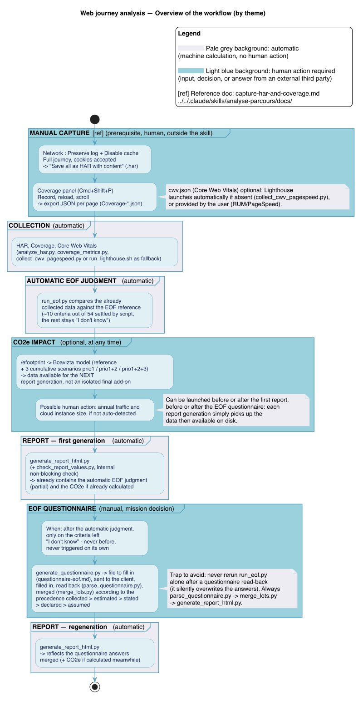
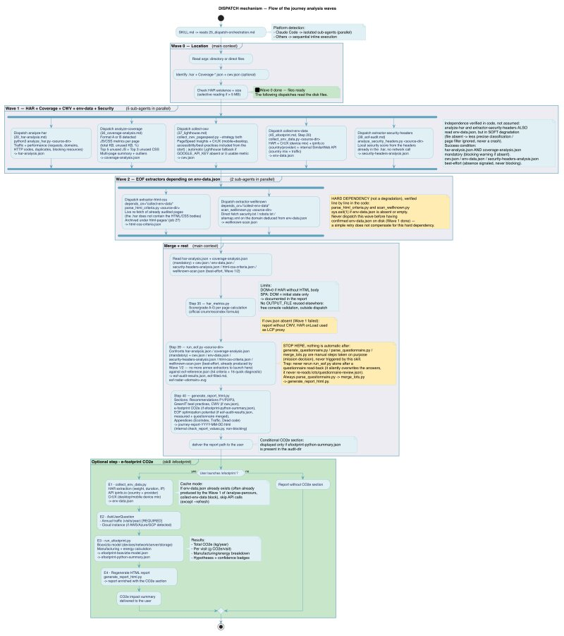
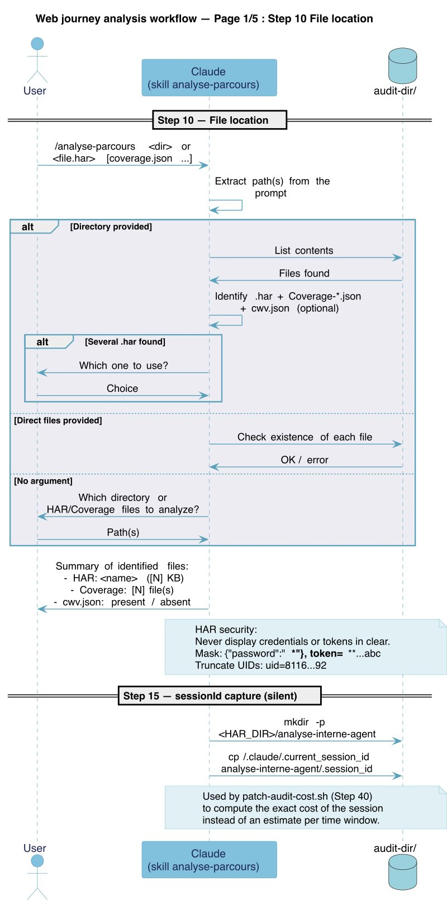
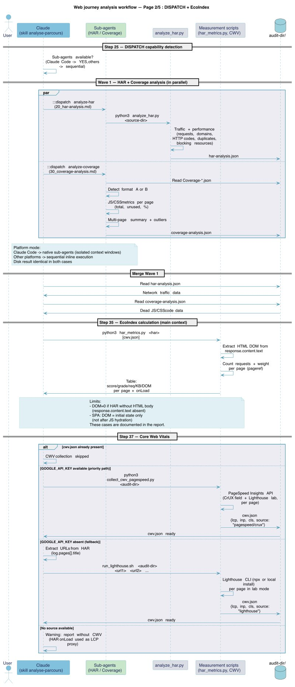
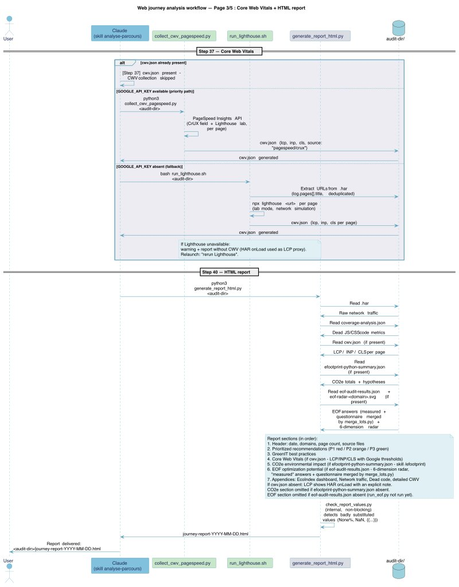
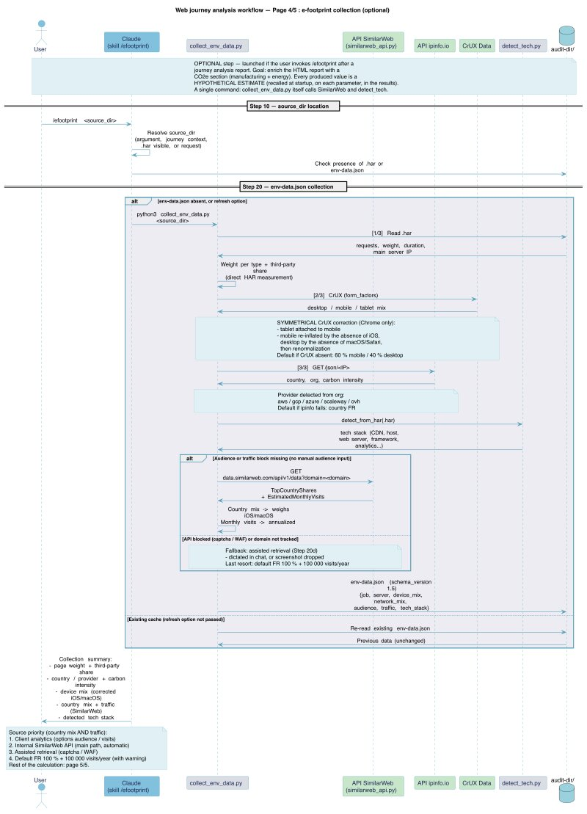
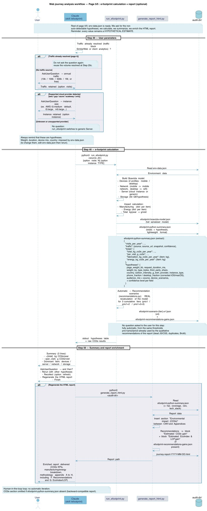
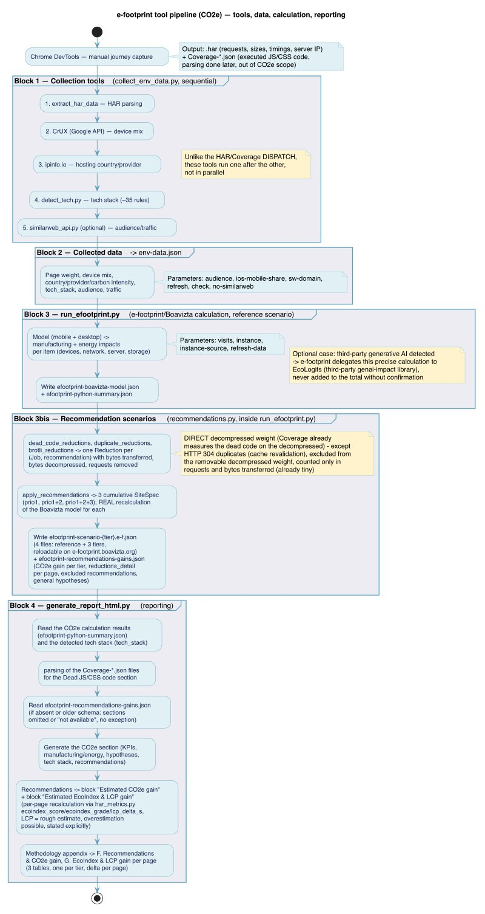

DISCLAIMER: THIS IS A WORK IN PROGRESS AND HAS NOT BEEN VALIDATED BY THE BOAVIZTA COMMUNITY.

# Agent EROOM

Tools and frameworks to diagnose the environmental impact of a digital service, from real data rather than generic averages.

**Current version: 1.2.1** — full version history in [`CHANGELOG.md`](CHANGELOG.md).

## Why this project exists

Most digital footprint estimates rely on generic assumptions: an "average page weight", an "average visit duration", an "average device mix". These averages hide what actually happens for a given user, on a given journey.

EROOM starts from a simple principle: measure first what really happens (the network traffic actually captured, the code actually executed, the third-party hosts actually contacted), then build the estimate on top of that measurement, never in its place. When a generic assumption is nevertheless necessary (hardware lifespan, electricity carbon intensity, length of a generative AI response...), it is made explicit: its value, its source, its confidence level are tracked and displayed, never drowned in a final figure presented as certain.

Two other principles guide the project's choices:

- **Multi-criteria rather than single-criteria.** A web journey is looked at from several angles at once: network traffic, dead code, perceived performance (Core Web Vitals), carbon footprint. None of these angles replaces the others.
- **A human stays in the loop.** The estimates produced feed a human decision (prioritize, arbitrate, alert); they do not automate it. No loop acts on its own based on a result.

## What the repository contains

The project brings together three families of tools, complementary but independent:

### `analyse-parcours`: technical diagnosis of a web journey

From a HAR capture (network traffic, Chrome DevTools export) and JS/CSS coverage files, this skill produces an HTML report with:

- the network traffic detail (requests, domains, volumes, HTTP codes);
- the EcoIndex score (0 to 100, grade A to G) and JS/CSS dead code;
- Core Web Vitals (field data via PageSpeed Insights/Chrome UX Report, failing that measured in the lab via Lighthouse);
- recommendations cross-referenced with the detected technical stack.

→ `.claude/skills/analyse-parcours/`

### `efootprint`: CO2e estimation of the journey

Optional step of the same skill, which reuses the data already captured (HAR, CrUX device mix, server country and host via ipinfo.io, annual traffic SimilarWeb) to build a model with the [e-footprint](https://github.com/Boavizta/e-footprint) library from Boavizta, and inserts an "Environmental impact" section into the report. When the journey calls a third-party generative AI, e-footprint delegates that specific calculation to a third-party library, EcoLogits.

What the e-footprint library measures, what it relies on and where its limits are is documented in plain terms in `documentation/implementation/efootprint-methodology.md`.

→ `.claude/skills/analyse-parcours/scripts/efootprint_model/`

### EROOM framework: quick eco-design diagnosis

A qualification grid of 16 criteria / 6 pillars, derived from the EOF framework, reviewed so that each criterion is a real question of degree and each evaluation is reproducible from one person (or agent) to another.

→ `.claude/skills/analyse-parcours/docs/Référenciel EROOM/`

-----

## Diagrams

Overview of the workflow (by theme), from manual journey capture to report regeneration after the questionnaire:



Zoom on the DISPATCH step (splitting the HAR/Coverage analysis into 2 parallel sub-agents):



Main workflow as a sequence diagram (5 pages: localization, DISPATCH, report, then e-footprint collection and calculation):











Tool pipeline of the e-footprint estimation (collection → Boavizta calculation → recommendation scenarios → delivery):



Printable versions (PDF): [overview](documentation/diagrammes/analyse-parcours-vue-generale.pdf) · [DISPATCH](documentation/diagrammes/analyse-parcours-dispatch-activite.pdf) · [workflow (sequence, 5 pages)](documentation/diagrammes/analyse-parcours-workflow.pdf) · [e-footprint (tool pipeline)](documentation/diagrammes/analyse-parcours-efootprint-outils.pdf).

The `.puml`/`.svg` sources and the regeneration procedure (complete registry of all the project's diagrams) are documented in the skill `.claude/skills/diagrammes-analyse-parcours/SKILL.md`.

-----

## Repository structure

```
.
├── .claude/skills/
│   ├── analyse-parcours/                      # The main skill (diagnosis + e-footprint)
│   │   ├── SKILL.md                           # Complete workflow (technical reference)
│   │   ├── docs/                              # Guides (HAR/Coverage capture, API keys...)
│   │   ├── skill-steps/                       # Detailed workflow steps
│   │   └── scripts/                           # analyze_har.py, run_efootprint.py, efootprint_model/...
│   ├── diagrammes-analyse-parcours/           # Diagram generation/maintenance skill
│   └── eof/                                   # EOF template generation skill (source framework)
├── audits/<audited-site-name>/                # Real audit results (HTML reports, e-footprint, EOF, topology)
├── documentation/
│   ├── diagrammes/                            # PlantUML diagrams (.puml, .svg, .pdf, .jpg, .pptx)
│   └── implementation/                        # e-footprint methodology, API key setup
├── EOF_study_Quick_and_fast_first_questionnaire/  # EOF framework study -> questionnaire
├── example-radar-eof/                 # SVG radar rendering demo (fictional data)
├── process/                                  # Multi-agent merge of EOF analysis lots
├── LICENSE
└── README.md
```

Under `audits/`, raw potentially sensitive data (`raw-data-potentially-sensitive/`, `html-pages/`, `SCOPE-CAPTURE.md`) is excluded from the repository at any depth.

-----

## Prerequisites

- [Claude Code](https://claude.com/claude-code)
- **Google Chrome** — manual capture of the HAR and JS/CSS coverage data via DevTools (see `.claude/skills/analyse-parcours/docs/capture-har-and-coverage.md`)
- **Python 3**, with the [`e-footprint`](https://github.com/Boavizta/e-footprint) library (CO2e estimation)
- **Node.js** — for Lighthouse (Core Web Vitals lab measurement as a fallback when CrUX/PageSpeed field data is not available), installed once via `npm install --prefix .claude/skills/analyse-parcours/scripts/`
- **Personal API keys**: PageSpeed Insights/Chrome UX Report and ipinfo.io (see `documentation/implementation/setup_Google_api_keys.md`)
- To regenerate the diagrams: `plantuml`, `rsvg-convert`, `magick` (ImageMagick) and `soffice` (LibreOffice, for the `.pptx` export)

-----

## Installation

```bash
git clone <remote-repo-URL>/eroom.git
cd eroom
```

Open the folder with Claude Code: the skills (`analyse-parcours`, `diagrammes-analyse-parcours`, `eof`) are detected automatically (`.claude/skills/`).

-----

## Quick start

These tools are used from [Claude Code](https://claude.com/claude-code), as skills invoked in natural language or by explicit command:

```
/analyse-parcours <folder-containing-the-HAR-and-coverage-files>
/efootprint <same-folder>          # CO2e estimation only
```

## Status

Active project, developed through real audits. Structuring decisions and known limits are documented in `documentation/`; the detailed history of choices lives in the commit messages. The version history is summarized in [`CHANGELOG.md`](CHANGELOG.md).

## License

This repository is distributed under the [Creative Commons Attribution-ShareAlike 4.0 International (CC BY-SA 4.0)](https://creativecommons.org/licenses/by-sa/4.0/) license. See `LICENSE`.

### Third-party projects and services used

The code in this repository relies on its own scripts to capture and analyze data (HAR, JS/CSS coverage...), but delegates some calculations or some data to third-party projects and services, listed below with their origin, authors and license:

- [e-footprint](https://github.com/Boavizta/e-footprint) (journey CO2e modeling) — Boavizta / Vincent Villet (Publicis Sapient) — [AGPL-3.0](https://www.gnu.org/licenses/agpl-3.0.html)

  - [boaviztapi](https://github.com/Boavizta/boaviztapi) (hardware impact data/calculations, used by e-footprint) — Boavizta — [AGPL-3.0](https://www.gnu.org/licenses/agpl-3.0.html)

  - [EcoLogits](https://github.com/mlco2/ecologits) (impact calculation for calls to a third-party generative AI, delegated by e-footprint) — mlco2, Samuel Rincé and Adrien Banse — [MPL-2.0](https://www.mozilla.org/en-US/MPL/2.0/)

- [PageSpeed Insights](https://developers.google.com/speed/docs/insights/v5/about) (API, field and lab data) — Google — service under [Google API Terms of Service](https://developers.google.com/terms)

- [Chrome UX Report (CrUX)](https://developer.chrome.com/docs/crux) (P75 field data, via the PageSpeed Insights API) — Google — data under [CC BY 4.0](https://creativecommons.org/licenses/by/4.0/)

- [Lighthouse](https://github.com/GoogleChrome/lighthouse) (fallback lab measurement of Core Web Vitals) — Google (GoogleChrome) — [Apache-2.0](https://github.com/GoogleChrome/lighthouse/blob/main/LICENSE)

- [GreenIT-Analysis](https://github.com/cnumr/GreenIT-Analysis) (DOM/page-weight measurement method that `analyze_har.py` draws on) — © EcoIndex.fr / Frédéric Bordage, authors of EcoMeter, didierfred@gmail.com, maintained by CNumr — [AGPL-3.0](https://www.gnu.org/licenses/agpl-3.0.html)

- [EcoIndex](https://github.com/cnumr/ecoindex_reference) (score calculation formula, reused in `har_metrics.py`) — CNumr (Collectif Conception Numérique Responsable), life-cycle analysis values © Frédéric Bordage — [CC BY-NC-ND 3.0](https://creativecommons.org/licenses/by-nc-nd/3.0/)

- [SimilarWeb](https://www.similarweb.com) (annual traffic estimation, via `similarweb_api.py`) — SimilarWeb Ltd — commercial service under SimilarWeb terms of use

- [ipinfo.io](https://ipinfo.io) (IP geolocation/hosting API, via `collect_env_data.py`) — IPinfo LLC — commercial service under IPinfo terms of use

Methodological inspiration (no code reused): the weighting of `analyze_security_headers.py` draws on [securityheaders.com](https://securityheaders.com) (Scott Helme).
